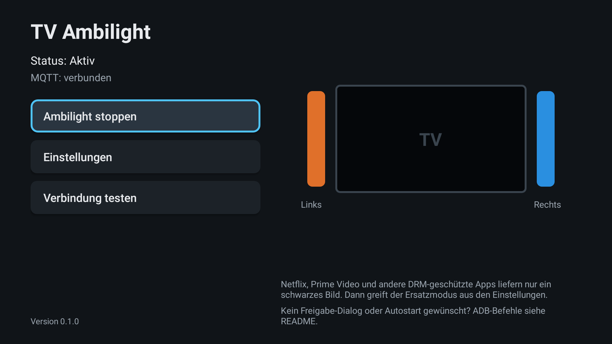
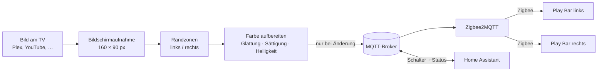
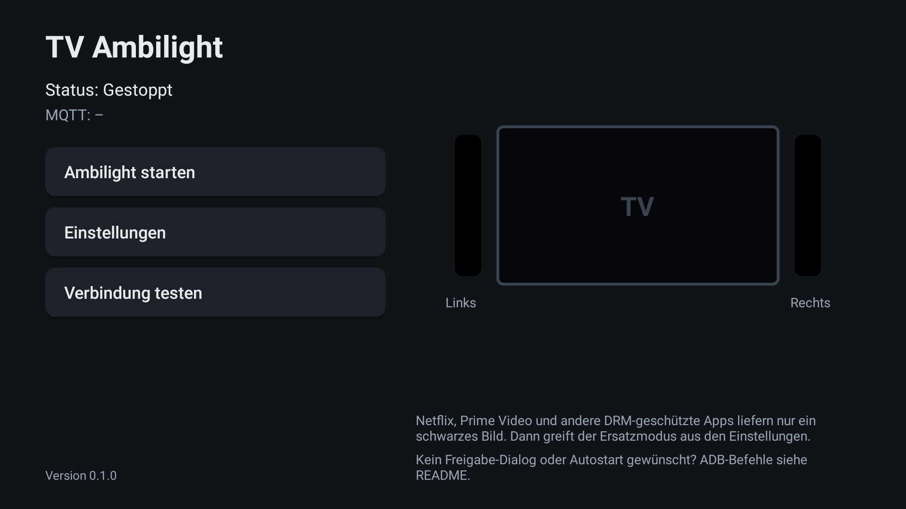
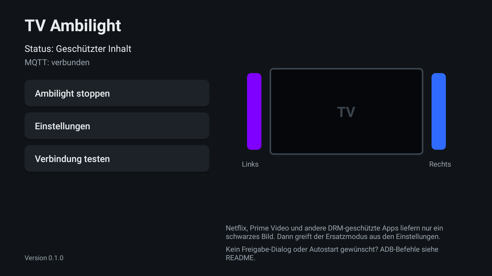
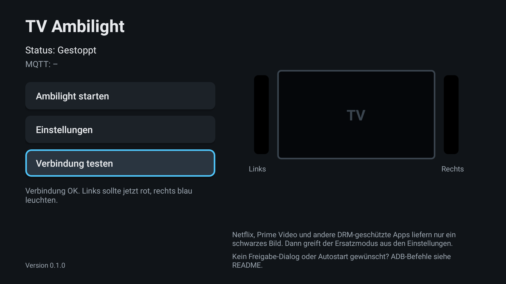
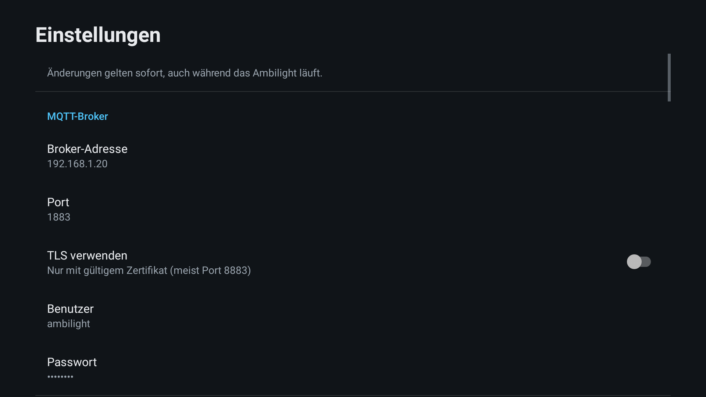
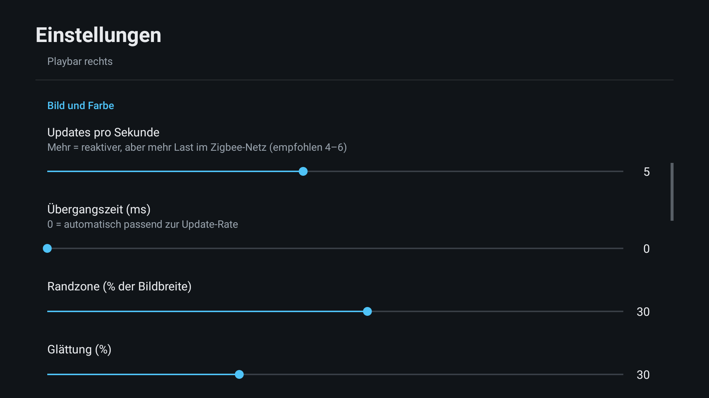
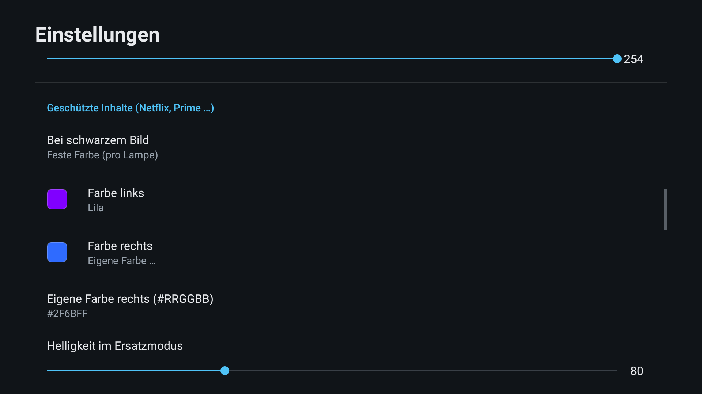
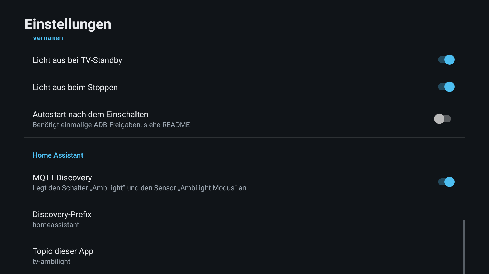
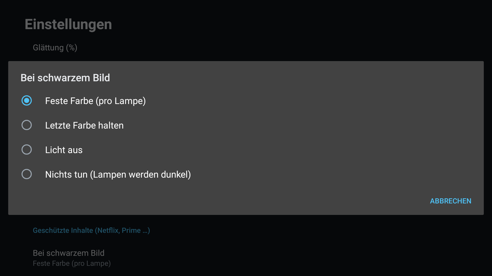

# TV Ambilight für Android TV

Ambilight zum Nachrüsten für Android-TVs (z. B. TCL) mit zwei Zigbee-Lampen hinter dem Fernseher, etwa Hue Play Bars links und rechts. Die App liest das Bild direkt am TV aus und steuert die Lampen über **MQTT → Zigbee2MQTT**. Eine Hue Bridge, eine Sync Box oder eine Kamera sind nicht nötig.



## So funktioniert es



1. **Bildschirmaufnahme:** Android spiegelt das Bild in einer Mini-Auflösung (160 × 90 Pixel) an die App. Das kostet kaum Leistung, und für Lichtfarben reicht diese Auflösung völlig.
2. **Randzonen:** Pro Seite wird ein Streifen (Standard 30 % der Bildbreite) zu einer Farbe gemittelt. Schwarze Balken von Kinofilmen (oben/unten) und 4:3-Inhalten (links/rechts) werden erkannt und übersprungen, damit die Lampen nicht vom Balken, sondern vom Bild gesteuert werden.
3. **Farbe aufbereiten:**
   - **Glättung** gegen Flackern.
   - **Sättigung** anheben, weil gemittelte Farben sonst blass wirken.
   - **Umrechnung in das Hue-Farbsystem** (CIE xy), damit die Farben möglichst originalgetreu ankommen.
   - **Helligkeit** folgt der Bildhelligkeit zwischen einstellbarem Minimum und Maximum.
4. **Sparsam senden:** Ein Befehl geht nur raus, wenn sich Farbe oder Helligkeit spürbar geändert haben, mit höchstens 5 Updates pro Sekunde (einstellbar). Das schont das Zigbee-Netz. Die Lampe blendet über `transition` selbst weich über.
5. **Zigbee2MQTT** setzt die Befehle (`zigbee2mqtt/<Lampe>/set`) auf Zigbee um, genauso wie bei Home Assistant.

## Funktionen

- Ambilight für alle Apps auf dem TV, die ihr Bild nicht schützen (z. B. Plex, Jellyfin, Live-TV-Apps, oft auch YouTube)
- **Ersatzmodus für Netflix, Prime & Co:** feste Farbe pro Lampe, letzte Farbe halten oder Licht aus
- Erkennung von Kino- und 4:3-Balken
- Automatisch Licht aus bei TV-Standby und beim Stoppen
- **Home Assistant:** Schalter zum Pausieren und Sensor mit dem aktuellen Modus, automatisch per MQTT-Discovery
- Verbindungstest auf Knopfdruck: links rot, rechts blau
- Autostart nach dem Einschalten (optional, braucht ADB-Freigaben)
- Bedienung komplett mit der Fernbedienung
- MQTT mit Benutzer/Passwort, optional TLS. Automatischer Reconnect, Offline-Meldung an Home Assistant bei Verbindungsabbruch.

## Oberfläche

### Startseite

| Gestoppt | Aktiv |
|---|---|
|  |  |
| Startpunkt nach dem Öffnen. **Ambilight starten** fragt einmal die Bildschirmfreigabe an und startet den Hintergrunddienst. | Status und MQTT-Verbindung oben. Rechts die Live-Vorschau der Farben, die gerade an die Lampen gehen. Der blaue Rahmen zeigt den Fokus der Fernbedienung. |

| Geschützter Inhalt | Verbindungstest |
|---|---|
|  |  |
| Netflix o. Ä. läuft, das Bild ist schwarz. Nach 2 s schaltet die App in den Ersatzmodus, hier links Lila und rechts Blau. | Prüft Broker, Login und Lampen-Namen, ohne das Ambilight zu starten: Die linke Lampe leuchtet rot, die rechte blau. So siehst du auch sofort, ob links und rechts vertauscht sind. |

Das Ambilight läuft als Hintergrunddienst weiter, wenn du die App verlässt. Gestoppt wird über die Startseite oder die Benachrichtigung.

### Einstellungen

| MQTT und Zigbee2MQTT | Bild und Farbe |
|---|---|
|  |  |
| Broker-Adresse und Port (der Broker, mit dem Z2M verbunden ist), Benutzer, Passwort, optional TLS. Darunter das Z2M-Base-Topic und die **Friendly Names** der beiden Lampen, exakt wie in Z2M. | **Updates pro Sekunde** (Reaktionszeit vs. Zigbee-Last), **Übergangszeit**, **Randzone**, **Glättung**, **Sättigung**, **minimale/maximale Helligkeit**. |

| Ersatzfarben | Home Assistant und Verhalten |
|---|---|
|  |  |
| Was bei schwarzem Bild passiert, plus eigene Farbe pro Lampe mit Farbvorschau und Helligkeit. | Licht aus bei Standby/Stopp, Autostart, MQTT-Discovery für Home Assistant, Discovery-Prefix und eigenes Topic. |

Änderungen gelten ab dem nächsten Start des Ambilights.

### Ersatzmodus für Netflix, Prime & Co

Streaming-Apps mit Kopierschutz (DRM) geben Android bei der Bildschirmaufnahme nur ein schwarzes Bild. Das ist vom System so gewollt und lässt sich per App nicht umgehen. Die App erkennt das: Ist das Bild länger als 2 Sekunden **komplett** schwarz, greift der Ersatzmodus. Sobald wieder ein echtes Bild kommt (Plex, Menü, YouTube), läuft das Ambilight normal weiter.

| Verhalten wählen | Farbe pro Lampe |
|---|---|
|  |  |
| **Feste Farbe (pro Lampe)**, **Letzte Farbe halten**, **Licht aus** oder **Nichts tun**. | Warm-, Neutral-, Kaltweiß, Rot, Orange, Gelb, Grün, Türkis, Blau, Lila, Pink oder **Eigene Farbe** als Hex-Wert (`#RRGGBB`). |

Normale dunkle Filmszenen lösen den Ersatzmodus nicht aus. Dort dimmen die Lampen wie gewohnt, denn echtes Videobild ist praktisch nie exakt schwarz.

## Home Assistant

Mit aktiver MQTT-Discovery erscheint in Home Assistant automatisch das Gerät **TV Ambilight** mit:

| Entität | Funktion |
|---|---|
| Schalter **Ambilight** | Aus = pausiert. Die App sendet nichts mehr, Home Assistant kann die Lampen frei steuern (z. B. Szene „Kino-Pause“). An = Ambilight läuft weiter. |
| Sensor **Ambilight Modus** | `Aktiv`, `Pausiert (Home Assistant)`, `Geschützter Inhalt`, `Standby`, `Gestoppt` |

Ist der TV aus oder die App beendet, werden beide Entitäten als „nicht verfügbar“ angezeigt.

Beispiel-Automation (Entitäts-IDs an deine Installation anpassen):

```yaml
- alias: Deckenlicht dimmen bei Netflix & Co
  triggers:
    - trigger: state
      entity_id: sensor.tv_ambilight_ambilight_modus
      to: "Geschützter Inhalt"
  actions:
    - action: light.turn_on
      target:
        entity_id: light.wohnzimmer_decke
      data:
        brightness_pct: 10
```

## Installation

Die fertige APK liegt unter [Releases](https://github.com/hxcde/AndroidTV-Ambilight/releases/latest). Direkter Link auf die jeweils neueste Version:

```
https://github.com/hxcde/AndroidTV-Ambilight/releases/latest/download/TV-Ambilight.apk
```

**Variante A: Sideload direkt am TV (ohne PC)**
- **Downloader-App** aus dem Play Store: den Link oben eingeben, laden, installieren.
- **USB-Stick:** APK draufkopieren und am TV mit einem Dateimanager öffnen (z. B. „X-plore“ oder „File Commander“).
- **„Send files to TV“:** APK vom Handy an den TV schicken.

Android fragt dabei einmalig, ob die App, mit der du installierst, „unbekannte Apps installieren“ darf. Das musst du erlauben.

**Variante B: per ADB vom PC**
```bash
adb install -r TV-Ambilight.apk
```

### Optionale ADB-Freigaben

Ohne ADB funktioniert die App, du bestätigst dann bei jedem Start den Freigabe-Dialog von Android. In zwei Fällen brauchst du einmalig ADB (vom PC oder per ADB-App vom Handy, Anleitung in [DOKU.md](./DOKU.md#installation-auf-dem-tv)):

- Dein TCL zeigt den Freigabe-Dialog **gar nicht** an, oder du willst ohne Dialog starten:
  ```bash
  adb shell appops set io.github.hxcde.ambilight PROJECT_MEDIA allow
  ```
- Du willst **Autostart** nach dem Einschalten:
  ```bash
  adb shell appops set io.github.hxcde.ambilight SYSTEM_ALERT_WINDOW allow
  ```

## Einrichtung

1. App öffnen → **Einstellungen**.
2. **Broker-Adresse:** IP des Rechners bzw. Containers, auf dem der MQTT-Broker läuft (z. B. im Zigbee2MQTT-Container). Port meist `1883`.
3. **Benutzer/Passwort:** am besten einen eigenen MQTT-Benutzer anlegen, z. B. `ambilight`.
4. **Base-Topic:** wie in Z2M (Standard `zigbee2mqtt`). **Lampe links/rechts:** Friendly Names aus der Z2M-Geräteliste.
5. Zurück → **Verbindung testen**: Links muss rot, rechts blau leuchten.
6. **Ambilight starten**, bei Bedarf die Bildschirmfreigabe bestätigen.

## Grenzen

- **DRM-Apps** (Netflix, Prime Video, Disney+, teils YouTube) liefern nur Schwarz, dafür gibt es den Ersatzmodus.
- **HDMI-Eingänge** des TVs laufen am Android-System vorbei und können nicht ausgelesen werden.
- **Zigbee ist kein Streaming-Protokoll.** Etwa 4–6 Updates pro Sekunde und Lampe sind realistisch; das reicht für flüssiges Stimmungslicht, aber nicht für Blitzeffekte. Das schnellere Hue-Entertainment-Streaming gibt es nur mit Hue Bridge.
- Auf einem echten TV ist die Version 0.1.0 noch nicht getestet. Rückmeldungen zu Update-Rate und Glättung gerne in [DOKU.md](./DOKU.md) nachtragen.

## Entwicklung

```bash
./gradlew assembleDebug
```
```bash
./gradlew testDebugUnitTest
```
```bash
./gradlew recordRoborazziDebug
```

Der letzte Befehl erzeugt die Screenshots in `docs/screenshots/` neu, ohne Emulator. Releases baut GitHub Actions automatisch bei einem Tag `v*` (siehe [DOKU.md](./DOKU.md#deployment--build)).

## Dokumentation

- [CODEINFO.md](./CODEINFO.md): Code-Struktur und Aufbau
- [DOKU.md](./DOKU.md): Einrichtung, Konfiguration, MQTT-Topics, Betrieb, Troubleshooting
