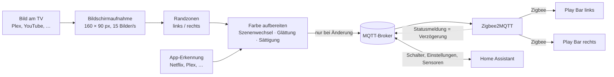
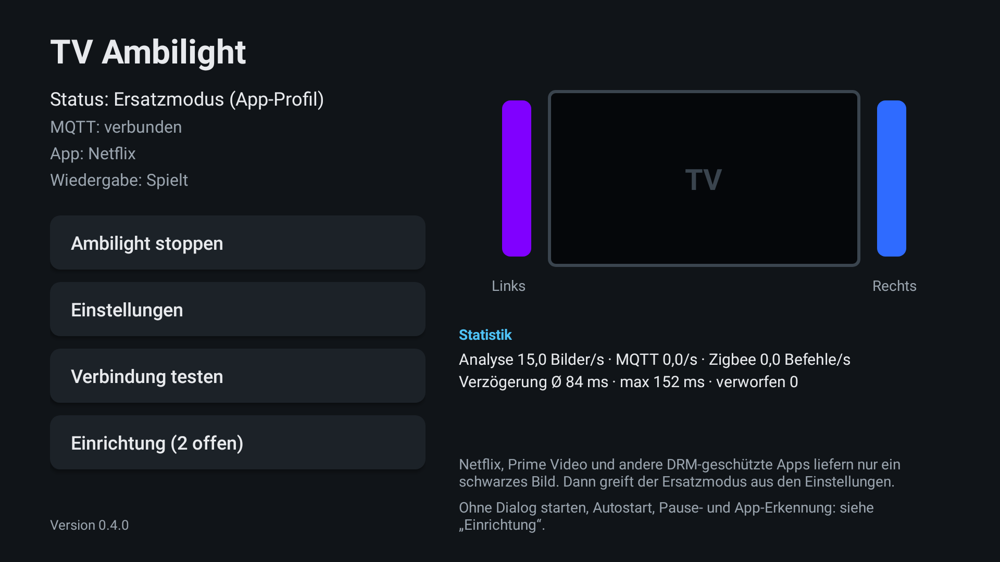
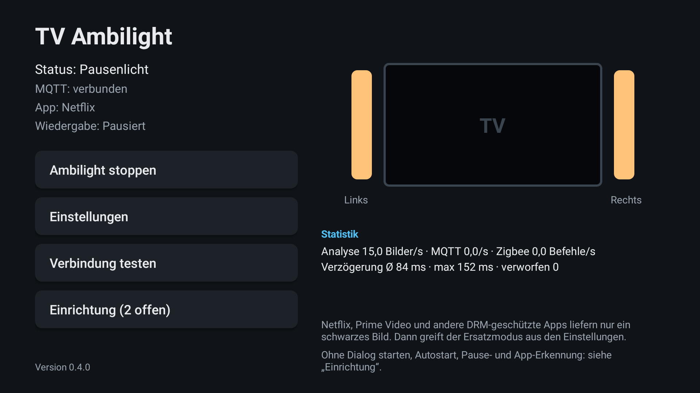
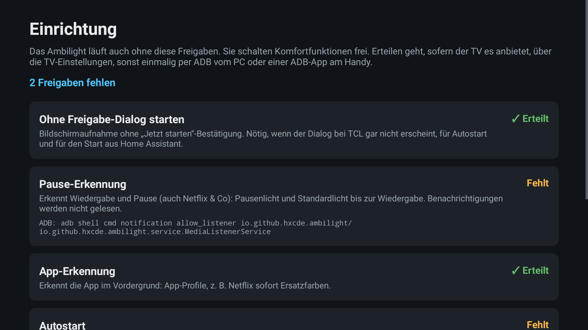
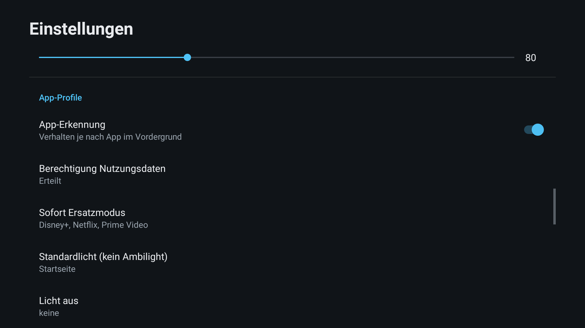
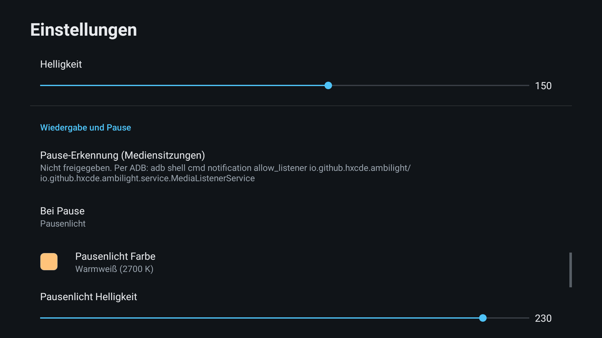
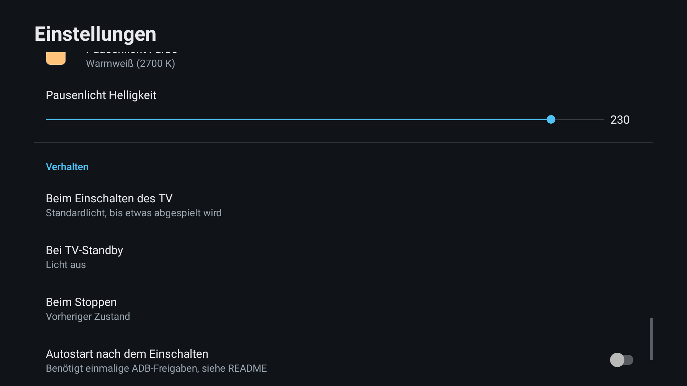
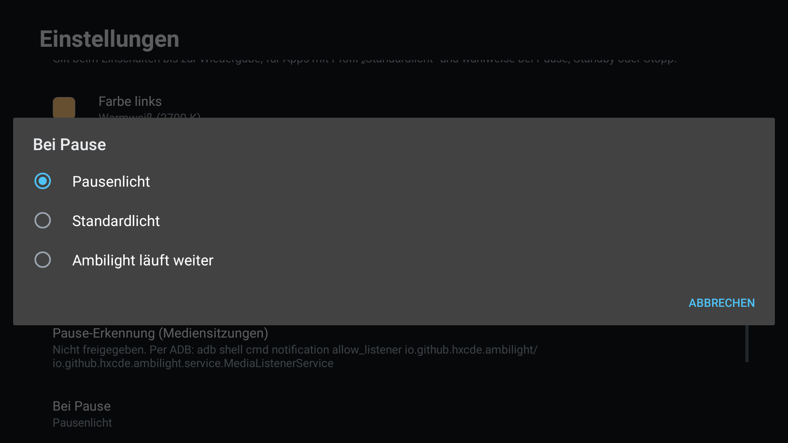
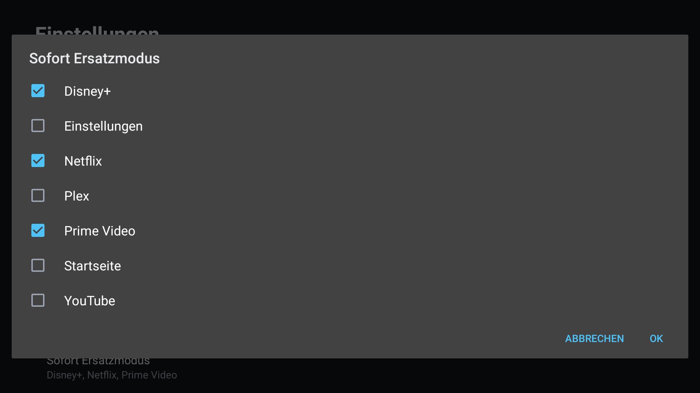
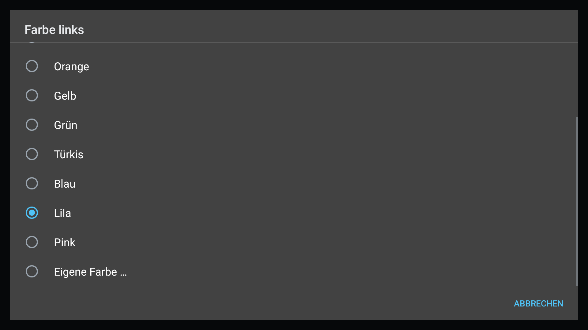

# TV Ambilight für Android TV

Ambilight zum Nachrüsten für Android-TVs (z. B. TCL) mit zwei Zigbee-Lampen hinter dem Fernseher, etwa Hue Play Bars links und rechts. Die App liest das Bild direkt am TV aus und steuert die Lampen über **MQTT → Zigbee2MQTT**. Eine Hue Bridge, eine Sync Box oder eine Kamera sind nicht nötig.


## So funktioniert es



1. **Bildschirmaufnahme:** Android spiegelt das Bild in einer Mini-Auflösung (160 × 90 Pixel) an die App. Analysiert wird 15-mal pro Sekunde; das kostet kaum Leistung, und für Lichtfarben reicht diese Auflösung völlig.
2. **Randzonen:** Pro Seite wird ein Streifen (Standard 30 % der Bildbreite) zu einer Farbe gemittelt. Schwarze Balken von Kinofilmen (oben/unten) und 4:3-Inhalten (links/rechts) werden erkannt und übersprungen, damit die Lampen nicht vom Balken, sondern vom Bild gesteuert werden.
3. **Farbe aufbereiten:**
   - **Szenenwechsel:** Ein harter Bildschnitt wird sofort und ohne Überblendung übernommen. Alles andere wird geglättet, damit nichts flackert.
   - **Sättigung** anheben, weil gemittelte Farben sonst blass wirken.
   - **Umrechnung in das Hue-Farbsystem** (CIE xy), damit die Farben möglichst originalgetreu ankommen.
   - **Helligkeit** folgt der Bildhelligkeit zwischen einstellbarem Minimum und Maximum, oder bleibt fest (siehe unten).
4. **Sparsam senden:** Zigbee ist das Nadelöhr, nicht die App. Ein Befehl geht nur raus, wenn sich Farbe oder Helligkeit spürbar geändert haben, im normalen Takt höchstens 5-mal pro Sekunde (einstellbar). Szenenwechsel dürfen sofort raus. Die Lampe blendet über `transition` selbst weich über.
5. **Zigbee2MQTT** setzt die Befehle (`zigbee2mqtt/<Lampe>/set`) auf Zigbee um. Seine Statusmeldung danach nutzt die App, um die echte Verzögerung bis zur Lampe zu messen.

## Funktionen

- Ambilight für alle Apps auf dem TV, die ihr Bild nicht schützen (z. B. Plex, Jellyfin, Live-TV-Apps, oft auch YouTube)
- **Szenenwechsel sofort:** harte Schnitte ohne Verzögerung und ohne Überblendung
- **Helligkeitsmodus „Fest“:** nur noch Farbe senden, halbiert die Zigbee-Last (ein statt zwei Befehle pro Update)
- **Ersatzmodus für Netflix, Prime & Co:** feste Farbe pro Lampe, letzte Farbe halten oder Licht aus
- **TV an → Standardlicht, TV aus → Licht aus:** Beim Einschalten gehen die Lampen auf ein frei wählbares Standardlicht (z. B. Warmweiß), bis etwas abgespielt wird; beim Ausschalten gehen sie aus.
- **Pausenlicht:** Wird ein Film pausiert (auch bei Netflix & Co), werden die Lampen nach 1 s z. B. hell warmweiß; beim Weiterschauen übernimmt sofort wieder das Ambilight.
- **App-Profile:** Die App erkennt, was gerade läuft. Netflix & Co → sofort Ersatzfarben ohne schwarze Pause; Startseite → Standardlicht; frei wählbar pro App.
- **Vorheriges Licht wiederherstellen:** Vor dem Start merkt sich die App den Zustand der Lampen und kann ihn bei Standby bzw. Stopp wiederherstellen.
- **Statistik auf der Startseite:** Bilder/s, MQTT- und Zigbee-Befehle/s, Verzögerung bis zur Lampe (Ø und max) und verworfene Updates
- **Home Assistant:** Schalter zum Pausieren, Sensoren (Modus, aktive App, Wiedergabe, Verzögerung, Zigbee-Last) und alle wichtigen Einstellungen als steuerbare Entitäten, automatisch per MQTT-Discovery
- **Home Assistant, erweitert:** Ersatz-, Standard- und Pausenlicht per **Farbrad**, **Live-Farben** der Lampen als Sensoren, **Beenden-Button**, Start aus HA per Android-TV-Remote-Integration, fertige **Blueprints**
- **Einrichtungsseite:** zeigt, welche optionalen Freigaben fehlen, wofür sie gut sind und wie man sie erteilt
- **Einstellungen gelten sofort**, auch während das Ambilight läuft
- Erkennung von Kino- und 4:3-Balken
- Verbindungstest auf Knopfdruck: links rot, rechts blau
- Autostart nach dem Einschalten (optional, braucht ADB-Freigaben)
- Bedienung komplett mit der Fernbedienung
- MQTT mit Benutzer/Passwort, optional TLS. Automatischer Reconnect, Offline-Meldung an Home Assistant bei Verbindungsabbruch.

## Oberfläche

### Startseite

| Gestoppt | Aktiv |
|---|---|
|  |  |
| Startpunkt nach dem Öffnen. **Ambilight starten** fragt einmal die Bildschirmfreigabe an und startet den Hintergrunddienst. | Status, MQTT-Verbindung und erkannte App oben. Rechts die Live-Vorschau der Farben, die gerade an die Lampen gehen, darunter die **Statistik**. Der blaue Rahmen zeigt den Fokus der Fernbedienung. |

| Netflix läuft (App-Profil) | Netflix pausiert (Pausenlicht) |
|---|---|
|  |  |
| Netflix ist als „Sofort Ersatzmodus“ eingetragen: Die Lampen springen beim Öffnen direkt auf die Ersatzfarben, hier links Lila und rechts Blau. Zigbee hat dann Pause. | Film pausiert: Nach 1 s gehen beide Lampen auf das Pausenlicht (hier hell warmweiß). Beim Weiterschauen geht es sofort zurück. |

| Verbindungstest | |
|---|---|
|  | Prüft Broker, Login und Lampen-Namen, ohne das Ambilight zu starten: Die linke Lampe leuchtet rot, die rechte blau. So siehst du auch sofort, ob links und rechts vertauscht sind. |

### Einrichtungsseite



Über **Einrichtung** auf der Startseite (zeigt „(2 offen)“, solange Freigaben fehlen). Für jede optionale Freigabe: Status, wofür sie gut ist, ein Knopf zur passenden TV-Einstellung (wenn der TV sie anbietet) und der ADB-Befehl. Unten steht ein einziger Befehl, der alles auf einmal freigibt.

### Läuft die App im Hintergrund?

Ja. Es muss nichts zusätzlich installiert werden: Der Dienst ist Teil der App und läuft als Android-Vordergrunddienst (mit Benachrichtigung „TV Ambilight“) weiter, wenn du die App verlässt, die App wechselst oder den TV in den Standby schickst. Er endet erst, wenn du ihn stoppst (Startseite oder Benachrichtigung).

- **TV aus/an (Standby):** Der Dienst bleibt aktiv, schaltet beim Ausschalten die Lampen aus und beim Einschalten auf das Standardlicht.
- **Kaltstart** (Netzstecker, Neustart, Update): Danach läuft der Dienst nur mit **Autostart** wieder an. Dafür braucht es einmalig die ADB-Freigaben `PROJECT_MEDIA` und `SYSTEM_ALERT_WINDOW` (siehe [Installation](#brauche-ich-adb)).
- Beendet die TCL-Firmware die Bildaufnahme im Standby, fragt die App sie beim Einschalten automatisch neu an (ebenfalls mit Autostart).

#### Statistik lesen

| Wert | Bedeutung | Richtwert |
|---|---|---|
| Analyse Bilder/s | Wie oft das Bild ausgewertet wird | ~15, solange sich das Bild bewegt; bei Standbild weniger |
| MQTT /s | Befehle an Zigbee2MQTT (beide Lampen) | ≤ 2 × Updates pro Sekunde |
| Zigbee Befehle/s | Was tatsächlich über Funk geht (Farbe und Helligkeit sind je ein Befehl) | Unter ~10 bleibt ein normales Zigbee-Netz entspannt |
| Verzögerung Ø / max | Zeit vom Senden bis zur Statusmeldung von Zigbee2MQTT | < 150 ms gut. Steigt sie stetig, ist das Zigbee-Netz überlastet → Updates pro Sekunde senken oder Helligkeit „Fest“. |
| verworfen | Updates, die durch ein neueres ersetzt wurden, bevor sie raus waren | Nahe 0. Steigt der Wert, hängt der Broker oder das Netz. |

### Einstellungen

| MQTT und Zigbee2MQTT | Bild und Farbe |
|---|---|
|  |  |
| Broker-Adresse und Port (der Broker, mit dem Z2M verbunden ist), Benutzer, Passwort, optional TLS. Darunter das Z2M-Base-Topic und die **Friendly Names** der beiden Lampen, exakt wie in Z2M. | **Updates pro Sekunde**, **Szenenwechsel sofort**, **Helligkeit** (Dynamisch oder Fest), **Übergangszeit**, **Randzone**, **Glättung**, **Sättigung**, **minimale/maximale Helligkeit**. |

| Ersatzfarben | App-Profile |
|---|---|
|  |  |
| Was bei schwarzem Bild passiert, plus eigene Farbe pro Lampe mit Farbvorschau und Helligkeit. | App-Erkennung an/aus, Status der Berechtigung und drei Listen: **Sofort Ersatzmodus**, **Standardlicht (kein Ambilight)** und **Licht aus**. |

| Standardlicht und Pause | Verhalten |
|---|---|
|  |  |
| **Standardlicht:** Farbe links/rechts und Helligkeit. **Wiedergabe und Pause:** Status der Pause-Erkennung, **Bei Pause** (Pausenlicht, Standardlicht oder Ambilight weiter), Farbe und Helligkeit des Pausenlichts. | **Beim Einschalten des TV** (Standardlicht bis zur Wiedergabe oder sofort Ambilight), **Bei TV-Standby** und **Beim Stoppen** (Licht aus, vorheriger Zustand, Standardlicht oder unverändert), Autostart. |

| Bei Pause | App-Auswahl |
|---|---|
|  |  |
| Was beim Pausieren passiert. | Alle installierten TV-Apps zum Ankreuzen. Netflix, Prime Video, Disney+, Apple TV und DAZN sind für „Sofort Ersatzmodus“ vorausgewählt. |

Alle Änderungen gelten sofort, auch während das Ambilight läuft. Geänderte Broker- oder Lampendaten bauen die Verbindung automatisch neu auf.

### Ersatzmodus für Netflix, Prime & Co

Streaming-Apps mit Kopierschutz (DRM) geben Android bei der Bildschirmaufnahme nur ein schwarzes Bild. Das ist vom System so gewollt und lässt sich per App nicht umgehen. Dafür gibt es zwei Auslöser:

1. **App-Profil (empfohlen):** Die App erkennt Netflix & Co beim Öffnen und schaltet sofort um, ohne schwarze Pause. Braucht einmalig eine ADB-Freigabe (siehe [Installation](#brauche-ich-adb)).
2. **Schwarzbild-Erkennung:** Ist das Bild länger als 2 Sekunden **komplett** schwarz, greift der Ersatzmodus ebenfalls. Bis dahin bleibt die letzte Farbe stehen. Normale dunkle Filmszenen lösen das nicht aus, denn echtes Videobild ist praktisch nie exakt schwarz.

| Verhalten wählen | Farbe pro Lampe |
|---|---|
|  |  |
| **Feste Farbe (pro Lampe)**, **Letzte Farbe halten**, **Licht aus** oder **Nichts tun**. | Warm-, Neutral-, Kaltweiß, Rot, Orange, Gelb, Grün, Türkis, Blau, Lila, Pink oder **Eigene Farbe** als Hex-Wert (`#RRGGBB`). |

Sobald wieder ein echtes Bild kommt bzw. die App gewechselt wird, läuft das Ambilight normal weiter.

### Einschalten, Ausschalten und Pause

So läuft ein typischer Fernsehabend mit den Standardeinstellungen:

| Moment | Lampen |
|---|---|
| TV einschalten | **Standardlicht** (z. B. Warmweiß, Helligkeit 150) |
| Startseite, Menüs, App-Auswahl | bleibt Standardlicht |
| Film startet (Plex, YouTube, …) | **Ambilight** |
| Netflix & Co starten | **Ersatzfarben** (App-Profil) |
| Pause (länger als 1 s) | **Pausenlicht** (z. B. hell warmweiß) |
| Weiterschauen | sofort zurück zu Ambilight bzw. Ersatzfarben |
| TV ausschalten | **Licht aus** |

Apps ohne Mediensitzung (z. B. Live-TV) beenden das Standardlicht beim Öffnen sofort, damit nichts hängen bleibt; das braucht die App-Erkennung.

Wiedergabe und Pause erkennt die App über die **Mediensitzungen** von Android. Das ist derselbe Mechanismus, über den Google Assistant oder die Fernbedienung „Pause“ an eine App senden; deshalb funktioniert es auch bei Netflix & Co, obwohl deren Bild geschützt ist. Android gibt diese Information nur an Apps heraus, die als **Benachrichtigungs-Listener** freigegeben sind. Die App nutzt das ausschließlich für den Wiedergabezustand und liest keine Benachrichtigungen. Ohne diese Freigabe startet das Ambilight beim Einschalten direkt, und es gibt kein Pausenlicht.

### Vorheriges Licht wiederherstellen

Beim Start fragt die App Zigbee2MQTT nach dem aktuellen Zustand beider Lampen (an/aus, Helligkeit, Farbe oder Farbtemperatur) und merkt ihn sich. Steht **Bei TV-Standby** oder **Beim Stoppen** auf **Vorheriger Zustand**, wird genau dieser Zustand wiederhergestellt. Hat Home Assistant die Lampen zwischendurch geändert (Pause per HA-Schalter), gilt der neue Zustand als Ausgangspunkt.

## Home Assistant

Mit aktiver MQTT-Discovery erscheint in Home Assistant automatisch das Gerät **TV Ambilight**:

| Entität | Typ | Funktion |
|---|---|---|
| Ambilight | Schalter | Aus = pausiert: Die App sendet nichts mehr, Home Assistant kann die Lampen frei steuern. An = Ambilight läuft weiter. |
| Ambilight beenden | Button | Beendet das Ambilight komplett (wie „Stoppen“ in der App) |
| Ambilight Modus | Sensor | `Aktiv`, `Standardlicht`, `Pausenlicht`, `Pausiert (Home Assistant)`, `Geschützter Inhalt`, `Ersatzmodus (App-Profil)`, `Standardlicht (App-Profil)`, `Licht aus (App-Profil)`, `Standby`, `Gestoppt` |
| Aktive App | Sensor | Name der App im Vordergrund, z. B. `Netflix` |
| Wiedergabe | Sensor | `Spielt`, `Pausiert`, `–` |
| Farbe links, Farbe rechts | Sensoren | Aktuelle Lampenfarbe als `#RRGGBB`, Attribut `rgb_color` für Dashboards; höchstens alle 2 s aktualisiert |
| Verzögerung, Zigbee-Befehle | Sensoren (Diagnose) | Ø-Verzögerung in ms und Zigbee-Befehle pro Sekunde, alle 10 s aktualisiert |
| Ersatzlicht links/rechts, Standardlicht links/rechts, Pausenlicht | Licht (Konfiguration) | **Farbrad und Helligkeit** für die festen Lichtfarben. Wirkt sofort, auch während der jeweilige Modus aktiv ist. Bleibt immer „an“, weil es eine Einstellung und keine Lampe ist. |
| Helligkeit maximal/minimal, Updates pro Sekunde, Glättung, Sättigung | Zahlen (Konfiguration) | Schieberegler, wirken sofort |
| Ersatzmodus, Helligkeitsmodus, Beim Einschalten, Bei Pause, Bei TV-Standby, Beim Stoppen | Auswahl (Konfiguration) | Wie in der App |
| Szenenwechsel sofort, App-Erkennung | Schalter (Konfiguration) | Wie in der App |

Ist der TV aus oder die App beendet, werden alle Entitäten als „nicht verfügbar“ angezeigt. Tipp: Die Live-Farben ändern sich laufend; wer sie nicht in der Historie braucht, schließt `sensor.tv_ambilight_farbe_links`/`_rechts` im `recorder` aus.

### Ambilight aus Home Assistant starten und beenden

- **Beenden:** Button „Ambilight beenden“.
- **Starten:** Läuft das Ambilight nicht, ist es auch nicht per MQTT erreichbar. Gestartet wird es deshalb über die in Home Assistant eingebaute Integration **Android TV Remote** (ohne ADB, Kopplung per PIN am TV). Sie öffnet den Link `tvambilight://start` am TV:

```yaml
script:
  ambilight_starten:
    alias: Ambilight starten
    sequence:
      - action: remote.turn_on
        target:
          entity_id: remote.wohnzimmer_tv
        data:
          activity: tvambilight://start
```

`tvambilight://stop` beendet es entsprechend. Ohne die Freigabe „Ohne Freigabe-Dialog starten“ erscheint am TV der Dialog „Jetzt starten“. Alternativ über die Integration „Android Debug Bridge“: `androidtv.adb_command` mit `am start -a android.intent.action.VIEW -d tvambilight://start`.

### Blueprints

Fertige Automationen, mit einem Klick in Home Assistant importierbar:

| Blueprint | Was er tut | Import |
|---|---|---|
| **Mit dem Fernseher starten** | Startet das Ambilight, sobald der TV eingeschaltet wird und es nicht schon läuft, z. B. nach einem Neustart. Braucht die Android-TV-Remote-Integration. | [](https://my.home-assistant.io/redirect/blueprint_import/?blueprint_url=https%3A%2F%2Fgithub.com%2Fhxcde%2FAndroidTV-Ambilight%2Fblob%2FHEAD%2Fblueprints%2Fautomation%2Ftv_ambilight%2Fmit_tv_starten.yaml) |
| **Raumlicht folgt der Wiedergabe** | Dimmt das Raumlicht beim Abspielen und macht es bei Pause heller (Helligkeiten, Verzögerung, Übergang einstellbar). | [](https://my.home-assistant.io/redirect/blueprint_import/?blueprint_url=https%3A%2F%2Fgithub.com%2Fhxcde%2FAndroidTV-Ambilight%2Fblob%2FHEAD%2Fblueprints%2Fautomation%2Ftv_ambilight%2Fraumlicht_folgt_wiedergabe.yaml) |
| **Abends dimmen** | Begrenzt die maximale Ambilight-Helligkeit abends und hebt sie morgens wieder an. Greift auch, wenn das Ambilight erst abends gestartet wird. | [](https://my.home-assistant.io/redirect/blueprint_import/?blueprint_url=https%3A%2F%2Fgithub.com%2Fhxcde%2FAndroidTV-Ambilight%2Fblob%2FHEAD%2Fblueprints%2Fautomation%2Ftv_ambilight%2Fabends_dimmen.yaml) |

Die Dateien liegen unter [`blueprints/automation/tv_ambilight/`](blueprints/automation/tv_ambilight/).

### Dashboard-Beispiel

```yaml
type: vertical-stack
cards:
  - type: tile
    entity: sensor.tv_ambilight_ambilight_modus
  - type: horizontal-stack
    cards:
      - type: tile
        entity: sensor.tv_ambilight_farbe_links
      - type: tile
        entity: sensor.tv_ambilight_farbe_rechts
  - type: tile
    entity: switch.tv_ambilight_ambilight
  - type: tile
    entity: light.tv_ambilight_pausenlicht
  - type: tile
    entity: button.tv_ambilight_ambilight_beenden
```

## Installation

Die fertige APK liegt unter [Releases](https://github.com/hxcde/AndroidTV-Ambilight/releases/latest). Direkter Link auf die jeweils neueste Version:

```
https://github.com/hxcde/AndroidTV-Ambilight/releases/latest/download/TV-Ambilight.apk
```

**Variante A: Sideload direkt am TV (ohne PC)**
- **Downloader-App** aus dem Play Store: den Link oben eingeben, laden, installieren.
- **USB-Stick:** APK draufkopieren und am TV mit einem Dateimanager öffnen (z. B. „X-plore“ oder „File Commander“).
- **„Send files to TV“:** APK vom Handy an den TV schicken.

Android fragt dabei einmalig, ob die App, mit der du installierst, „unbekannte Apps installieren“ darf. Das musst du erlauben.

**Variante B: per ADB vom PC**
```bash
adb install -r TV-Ambilight.apk
```

### Brauche ich ADB?

Nein. Sideloaden reicht, und das Ambilight läuft. ADB (oder die passende TV-Einstellung) braucht es nur für Komfortfunktionen:

| Funktion | Ohne ADB | Freigabe |
|---|---|---|
| Ambilight, Ersatzmodus bei Schwarzbild, Home Assistant, Statistik, Licht aus bei Standby | ✅ Bei jedem Start „Jetzt starten“ bestätigen | – |
| Ohne Bestätigung starten; Start aus Home Assistant ohne Dialog | ❌ | `PROJECT_MEDIA` (nur per ADB) |
| Pausenlicht, Standardlicht bis zur Wiedergabe | ❌ | Pause-Erkennung (Benachrichtigungszugriff) |
| App-Profile (Netflix sofort Ersatzfarben) | ❌ (nach 2 s Schwarzbild trotzdem Ersatzmodus) | App-Erkennung (Nutzungsdatenzugriff) |
| Autostart nach Neustart | ❌ (alternativ: Blueprint „Mit dem Fernseher starten“) | Über anderen Apps einblenden |

Manche TCL-Firmwares zeigen den Freigabe-Dialog gar nicht an; dann ist `PROJECT_MEDIA` per ADB Pflicht. Drei der vier Freigaben bieten manche TVs auch direkt in den Einstellungen an (Apps → Spezieller App-Zugriff). Die Seite **Einrichtung** in der App zeigt, was fehlt, und öffnet die passende TV-Einstellung, sofern vorhanden.

Alle Freigaben auf einmal per ADB (PC im selben Netz, vorher am TV Netzwerk-Debugging aktivieren, siehe [DOKU.md](./DOKU.md#installation-auf-dem-tv)):

```bash
adb connect <TV-IP>:5555
```
```bash
adb shell "appops set io.github.hxcde.ambilight PROJECT_MEDIA allow; cmd notification allow_listener io.github.hxcde.ambilight/io.github.hxcde.ambilight.service.MediaListenerService; appops set io.github.hxcde.ambilight GET_USAGE_STATS allow; appops set io.github.hxcde.ambilight SYSTEM_ALERT_WINDOW allow"
```

Danach in der App **Autostart** einschalten. Ohne PC geht das auch mit einer ADB-App auf dem Handy (z. B. „Bugjaeger“).

## Einrichtung

1. App öffnen → **Einstellungen** (optional vorher **Einrichtung** ansehen).
2. **Broker-Adresse:** IP des Rechners bzw. Containers, auf dem der MQTT-Broker läuft (z. B. im Zigbee2MQTT-Container). Port meist `1883`.
3. **Benutzer/Passwort:** am besten einen eigenen MQTT-Benutzer anlegen, z. B. `ambilight`.
4. **Base-Topic:** wie in Z2M (Standard `zigbee2mqtt`). **Lampe links/rechts:** Friendly Names aus der Z2M-Geräteliste.
5. Zurück → **Verbindung testen**: Links muss rot, rechts blau leuchten.
6. **Ambilight starten**, bei Bedarf die Bildschirmfreigabe bestätigen.
7. Unter **Standardlicht** und **Wiedergabe und Pause** die Farben und Helligkeiten nach Geschmack einstellen.
8. Ein paar Minuten schauen und die **Statistik** prüfen. Ist die Verzögerung hoch oder wächst sie, die Updates pro Sekunde senken oder die Helligkeit auf **Fest** stellen.

## Grenzen

- **DRM-Apps** (Netflix, Prime Video, Disney+, teils YouTube) liefern nur Schwarz, dafür gibt es Ersatzmodus und App-Profile.
- **HDMI-Eingänge** des TVs laufen am Android-System vorbei und können nicht ausgelesen werden.
- **Zigbee ist kein Streaming-Protokoll.** Etwa 4–6 Updates pro Sekunde und Lampe sind realistisch (mit Helligkeit „Fest“ etwas mehr); das reicht für flüssiges Stimmungslicht, aber nicht für Blitzeffekte. Das schnellere Hue-Entertainment-Streaming gibt es nur mit Hue Bridge.
- Auf einem echten TV ist die Version 0.4.0 noch nicht getestet; ebenso der Start per Android-TV-Remote-Integration (`tvambilight://start`) und die Blueprints. Rückmeldungen zu Update-Rate und Glättung gerne in [DOKU.md](./DOKU.md) nachtragen.

## Entwicklung

```bash
./gradlew assembleDebug
```
```bash
./gradlew testDebugUnitTest
```
```bash
./gradlew recordRoborazziDebug
```

Der letzte Befehl erzeugt die Screenshots in `docs/screenshots/` neu, ohne Emulator. Releases baut GitHub Actions automatisch bei einem Tag `v*` (siehe [DOKU.md](./DOKU.md#deployment--build)).

## Dokumentation

- [CODEINFO.md](./CODEINFO.md): Code-Struktur und Aufbau
- [DOKU.md](./DOKU.md): Einrichtung, Konfiguration, MQTT-Topics, Betrieb, Troubleshooting
